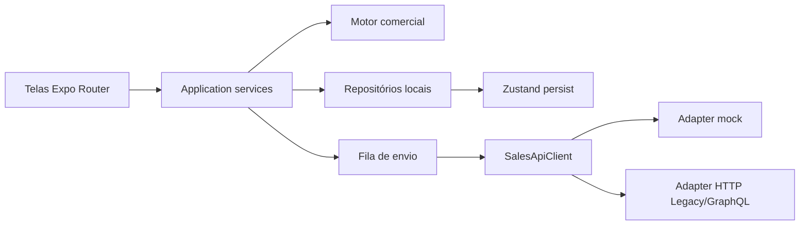

# Arquitetura — v1

## Stack

| Camada | Tecnologia | Justificativa (premissa atendida) |
|---|---|---|
| App | Expo (React Native) + TypeScript + Expo Router | Um código Android + iOS; Expo Web permite o Tester validar no browser. |
| Estado / offline | Zustand + persistência (AsyncStorage / web localStorage) | Pedido e cadastros sobrevivem sem rede; fila simples e auditável. |
| Motor comercial | Módulo puro TypeScript `src/domain` | Regras testáveis sem UI; paridade com `ProdutoPedido` / `Manipula_pedido`. |
| Integração | Porta `SalesApiClient` + adapters `mock` / `http` | Q-003: E2E sem o monólito no ar; contrato = `EnvioDePedidoDoMobile`. |
| Testes | Vitest (domínio + fila) | Feedback rápido no Windows; sem emulador para a regra de negócio. |
| UI | StyleSheet + tokens próprios | Tela clean, big numbers, CTAs evidentes; sem dependência de design system externo. |

## ADRs

### ADR-001 — Expo em vez de nativo duplo ou Flutter
- Contexto: Android + iOS, time único, verificação no browser.
- Decisão: Expo SDK + TypeScript.
- Consequências: publicação via EAS depois; Onda 1 valida em Expo Web.

### ADR-002 — Servidor Sales API não é alterado
- Contexto: origem é legado Yii; PM tirou mudança de backend do escopo.
- Decisão: app consome o contrato já usado pelo mobile (`EnvioDePedidoDoMobile` / Legacy) e GraphQL de leitura.
- Consequências: Onda 1 sobe com adapter mock fiel ao contrato; `EXPO_PUBLIC_API_MODE=mock|http`.

### ADR-003 — Motor comercial no aparelho, autoridade no envio
- Contexto: offline precisa de preço/desconto imediatos; flags de tenant divergem.
- Decisão: calcular localmente; o despacho revalida no servidor (ou no mock que replica as mesmas regras).
- Consequências: aviso “sujeito a revalidação” quando faltar acumulado/cupom online (Q-004).

### ADR-004 — Persistência documental da fila
- Contexto: SQLite nativo complica o target web do Tester.
- Decisão: store Zustand persistido. Suficiente para carteira de um representante.
- Consequências: se o volume crescer na Onda 3, migrar para `expo-sqlite` sem mudar o domínio.

## Visão de arquitetura



Módulos:
- `src/domain` — entidades, motor, validações, status.
- `src/data` — fixtures, repositórios, persistência.
- `src/api` — porta e adapters.
- `src/sync` — detector de rede + worker da fila.
- `app` — rotas: login, home/metas, clientes, novo pedido, revisão, fila, acompanhamento.

## Contratos

Envio (espelho de `EnvioDePedidoDoMobile`):

```ts
type SubmitOrderPayload = {
  order_client_id: string;
  codigo_pedido?: string;
  id_cliente: number;
  id_tabela: number;
  id_usuario: number;
  datahora_criacao: string;
  array_ordem_envio: { id_distribuidor: number; prioridade: number; tipo_envio: 1 | 2 }[];
  array_produtos: { ean: string; quantidade: number; desconto?: number }[];
  array_agendamento?: { data_envio: string }[];
  justificativa?: string;
};
```

Resposta: `{ id_pedido_gerado, id_status, erros_envio[] }`.

Leitura de acompanhamento: lista + detalhe com `quant_ped` / `quant_esp` / `quant_not`, status, NF.

Metas: `{ metaValor, realizadoValor, metaQtd, realizadoQtd, pdvsAPositivar }`.

## Migração de dados

Sem migração histórica. O aparelho só cacheia a carteira do usuário logado. Pedidos antigos entram pela API de consulta quando houver rede.

## Tarefas técnicas — Onda 1

| ID | Onda | Features | Descrição | Módulos | Critério de conclusão | Depende de |
|---|---|---|---|---|---|---|
| T-001 | 1 | — | Scaffold Expo + TypeScript + Vitest + tokens de UI | `package.json`, `app/`, `src/` | `npm test` e `npx expo export --platform web` (ou start) sobem | — |
| T-002 | 1 | F-007, F-008 | Motor comercial + validações com testes | `src/domain` | Testes de faixa, gatilho, combo, cupom, mínimo, fracionamento verdes | T-001 |
| T-003 | 1 | F-002, F-012 | Fixtures de carteira, tabelas, metas e pedidos | `src/data/fixtures` | Home e catálogo alimentados sem API | T-001 |
| T-004 | 1 | F-001, F-009 | Auth demo, store persistido, fila idempotente | `src/data`, `src/sync`, `src/api` | Pedido offline entra na fila e o mock envia 1x | T-002 |
| T-005 | 1 | F-003–F-006, F-008 | Fluxo de digitação (PDV → tabela → itens → revisão) | `app/pedido` | Cesta recalcula e bloqueia envio inválido | T-002, T-003 |
| T-006 | 1 | F-011, F-012 | Home (big numbers) + lista/detalhe de acompanhamento | `app/index`, `app/pedidos` | Timeline até faturado; CTA novo pedido | T-003, T-004 |
| T-007 | 1 | F-009 | Worker de sync ao recuperar rede + estados da fila | `src/sync` | Offline→online envia automaticamente | T-004 |
| T-008 | 1 | Must | Testes de aplicação (fila, store) e ajuste visual mobile | `src/**/*.test.ts` | `npm test` 100% verde | T-002–T-007 |
